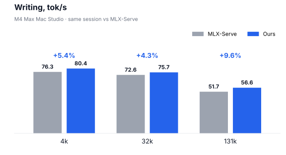

# Faster Inkling 2 Mini

**Optimised quality at highest speed.** Inkling 2 Mini with the official weights exactly as shipped, on an M4 Max Mac
Studio. It writes faster than MLX-Serve at 4k, 32k, 131k and 262k and reads faster at 32k, 131k and 262k; at 4k, reading is level.

No requantizing, no FP8 KV cache, no sparse or approximate attention, and the outputs match the reference
implementation. The speed comes from engineering alone: custom Metal kernels, a reworked server pipeline and fixes to
the draft head.

- **+5.4% faster writing** than MLX-Serve at 4k, **+4.3%** at 32k, **+9.6%** at 131k and **+18.3%** at 262k
- **+3.2% faster reading** at 32k, **+4.7%** at 131k and **+6.2%** at 262k, **level** at 4k
- **8/8** greedy answers identical to the reference and **520/520** teacher-forced top-1 tokens on our quality gate
  ([on which stack](#quality))
- The hidden fact found in **18/18** of our head-to-head answers

## Quickstart

macOS on Apple Silicon. Measured on an M4 Max Mac Studio with 64 GB only. The weights are about 18 GiB.

```bash
git clone https://github.com/tomascupr/inkling-mini-mac-longctx && cd inkling-mini-mac-longctx
bash scripts/install.sh      # fork + patches + venv (mlx 0.32.4) in ~/inkling-mini
hf download thinkingmachines/Inkling-2-Mini --local-dir ~/inkling-mini/models/Inkling-2-Mini
bash scripts/serve.sh 8080   # OpenAI-compatible server with the benchmarked settings
```

```bash
curl -s http://127.0.0.1:8080/v1/chat/completions -H 'Content-Type: application/json' -d '{
  "model": "'"$HOME"'/inkling-mini/models/Inkling-2-Mini",
  "messages": [{"role": "user", "content": "Explain speculative decoding in two sentences."}],
  "max_tokens": 256, "temperature": 0}'
```

`serve.sh` serves one request at a time with the draft head on for 1,024 to 262,144 context tokens
(`NO_DRAFT=1 bash scripts/serve.sh` turns it off). Every setting it uses: [docs/BENCHMARKS.md](docs/BENCHMARKS.md#settings-and-environment-variables).

## Against MLX-Serve: same Mac, same session

[MLX-Serve](https://github.com/ddalcu/mlx-serve) is a strong, fast Inkling 2 Mini server for Apple Silicon, so it is
the baseline. In each session both servers ran on the same M4 Max Mac Studio, MLX-Serve first, with the same official
weights, the same prompts and their draft heads on. Every run is the server's own log line.

<!-- To add a prompt length (for example 524k): list its session log under "h2h_sessions" in
     results/h2h-20261122/charts.json and run `python scripts/charts.py`. The table, both charts, the BENCHMARKS
     tables and the X renders (docs/img/x-*.png) are regenerated with the same counting, rounding and verdict rules. Then bring the title, subline and bullets above in line with the new row: faster only where its
     verdict says faster. -->
<!-- gen:h2h-table -->
| Prompt | Reading, tok/s<br>MLX-Serve → ours | Writing, tok/s<br>MLX-Serve → ours |
|---|---:|---:|
| 4k (4,078 tokens) | 1,036.2 → 1,039.8, level | 76.3 → 80.4, **+5.4%** |
| 32k (32,750 tokens) | 898.4 → 927.8, **+3.2%** | 72.6 → 75.7, **+4.3%** |
| 131k (131,054 tokens) | 674.0 → 706.2, **+4.7%** | 51.7 → 56.6, **+9.6%** |
| 262k (262,126 tokens) | 477.9 → 507.9, **+6.2%** | 32.1 → 38.0, **+18.3%** |

<sub>Same-session runs on an M4 Max Mac Studio. Method and every raw run: [docs/BENCHMARKS.md](docs/BENCHMARKS.md#head-to-head-vs-mlx-serve).</sub>
<!-- /gen:h2h-table -->




## What's different

**Custom Metal kernels that keep MLX's arithmetic.** Reading a prompt runs through fused kernels for the attention
residuals, message gates, MoE combine, l2 clips and sliding-window attention. Each one adds its numbers in exactly the
order MLX does, so the results are bit for bit those of the unfused code, in fewer and larger GPU passes. The latest
two: sliding-window attention in 64-query blocks (+2.4% reading at 4k, +2.2% at 32k) and the l2 clips as one kernel
per call (+1.2% at 4k, +0.8–0.9% at 32k).

**A server that takes the fast path.** The server was decoding without the compiled step, and it ran the draft head
through a batching path with no exact verifier. Fixing both took server writing at 4k from 44.0 to 60.1–60.6 tok/s
without the draft and from 31.1 to 77.5–81.6 tok/s with it. Then the last prompt chunk and the last token went into
one forward pass, and three server settings changed: an 8192-token prefill chunk, per-layer work queued
asynchronously, and no 1 GiB buffer-cache limit (it made prefill re-allocate its buffers on every layer). The three
settings took 32k server reading from 863.4–864.2 to 899.3–901.3 tok/s.

**Draft-head fixes.** Inkling ships a small draft head that guesses several tokens ahead. Its guesses are checked with
exactly the arithmetic of normal one-token-at-a-time decoding, so the output is the same tokens as without it. The
check stops at the first low-confidence guess, the draft proposes from a 16k-token candidate list plus the prompt's
own tokens, and the server now hands the draft head the prompt, which it didn't before (4k server writing 68.2–68.9
to 80.2–80.6 tok/s).

**Long context on 64 GB.** The same code base reads a 1,048,558-token prompt on one 64 GB Mac Studio and finds the fact
hidden in it (175.6 tok/s reading, 11.38 tok/s writing; command line, draft head off, measured before the latest
prefill kernels).

What we tried that didn't work, with numbers: [docs/BENCHMARKS.md](docs/BENCHMARKS.md#what-did-not-work).

## Quality

- Official weights exactly as Thinking Machines ships them (NVFP4 + MXFP8), bf16 KV cache.
- Quality gate on the stack through patch 0018: through the draft head, greedy answers are identical to the reference
  (the unpatched community fork this repo builds on) on 8/8 prompts, and teacher-forced top-1 agrees on 520/520 tokens.
- The two kernel changes added after that gate were bitwise-equal in their own tests. The full gate has not yet been
  re-run on the exact final stack, nor with `serve.sh`'s settings (an 8192-token prefill chunk where the gate used 2048):
  [what is verified on what](docs/BENCHMARKS.md#quality-what-is-verified-on-what).

## Docs

- [docs/BENCHMARKS.md](docs/BENCHMARKS.md): method, every raw run, quality evidence, settings, what didn't work, long context.
- [docs/EXPERIMENTS.md](docs/EXPERIMENTS.md): the full experiment log, failures included.
- [docs/PREFILL_TECHNIQUES.md](docs/PREFILL_TECHNIQUES.md), [docs/PRIOR_ART.md](docs/PRIOR_ART.md).

## Built on

[betizzel/mlx-vlm `m5pro-inkling2`](https://github.com/betizzel/mlx-vlm/tree/m5pro-inkling2) (itself built on
[inkling2-mlx](https://github.com/internet-projects/inkling2-mlx)) with jundot's relative-attention kernel from
[ml-explore/mlx-lm#2086](https://github.com/ml-explore/mlx-lm/pull/2086), on [mlx-vlm](https://github.com/Blaizzy/mlx-vlm)
and Apple's [MLX](https://github.com/ml-explore/mlx). [MLX-Serve](https://github.com/ddalcu/mlx-serve) by ddalcu is
the strong baseline we measured against. Inkling 2 Mini is by Thinking Machines Lab.

MIT licensed (see `LICENSE`); hunks touching the Apache-2.0 `inkling2_loop` files stay Apache-2.0.
