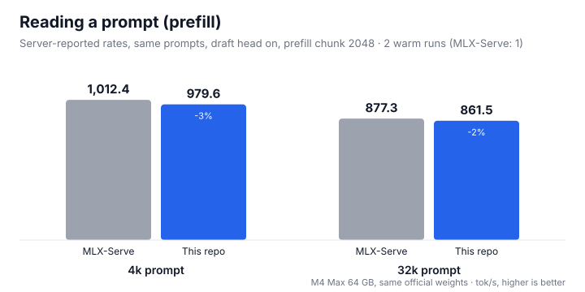
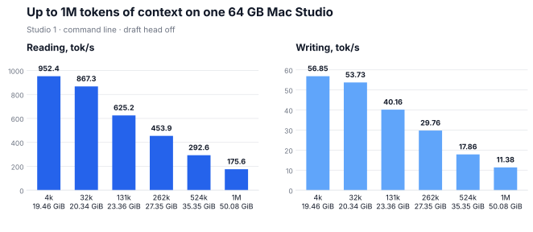

# Inkling 2 Mini on a Mac, fast

**Full quality on the official weights · up to 2.8× faster than the standard MLX build · 1M-token context on a 64 GB M4 Max.**

Thinking Machines' Inkling-2-Mini, tuned for one Mac Studio (M4 Max, 64 GB). Speculative decoding is on by default and
writes exactly the tokens the model would write without it, and the same build reads a full 1M-token document on a
single 64 GB machine and finds the fact hidden inside. Here it is next to MLX-Serve, on the same Mac, the same
official weights and the same prompts:






Charts are drawn by `scripts/charts.py` straight from the server logs in `results/h2h-20261122/` and the run files
in `results/gates/`. Full tables, methods and what is not measured yet: [docs/BENCHMARKS.md](docs/BENCHMARKS.md).

## How it's fast

- **Exact draft verifier + confidence cut + draft vocabulary list:** the DSpark draft head's guesses are checked with
  the same GPU arithmetic as normal writing (same tokens), the check stops at the first unlikely guess, and the draft
  proposes from a 16k-token candidate list.
- **Fused prefill kernels** that keep MLX's own order of additions, so they stay bit-identical.
- **Compiled decode in the server**, the same compiled step the command line uses.
- **Attention tiles (KT=3)** that stage three key blocks per barrier for long-context reading.
- **Vocabulary tables in host memory** during 1M-token reads, which keeps the GPU under MLX's buffer-cache limit.

## Quality

Official weights as shipped (NVFP4 + MXFP8): no re-quantization, no FP8 KV cache, no sparse or approximate attention.
With the defaults, the answers match the reference fork's token for token on our fixed 8-prompt set (8/8) and the
hidden fact is found at 4k through 1M.

## Install

```bash
git clone https://github.com/tomascupr/inkling-mini-mac-longctx && cd inkling-mini-mac-longctx && bash scripts/install.sh && hf download thinkingmachines/Inkling-2-Mini --local-dir ~/inkling-mini/models/Inkling-2-Mini && source scripts/env.sh
```

## Credits

Built on [betizzel/mlx-vlm `m5pro-inkling2`](https://github.com/betizzel/mlx-vlm/tree/m5pro-inkling2), which ports
jundot's `relative_attention` kernel from [ml-explore/mlx-lm#2086](https://github.com/ml-explore/mlx-lm/pull/2086).
Also on [inkling2-mlx](https://github.com/internet-projects/inkling2-mlx), [MLX-VLM](https://github.com/Blaizzy/mlx-vlm)
and Apple's [MLX](https://github.com/ml-explore/mlx). Inkling-2-Mini is by Thinking Machines Lab.

MIT licensed (see `LICENSE`); hunks touching the Apache-2.0 `inkling2_loop` files stay Apache-2.0.
