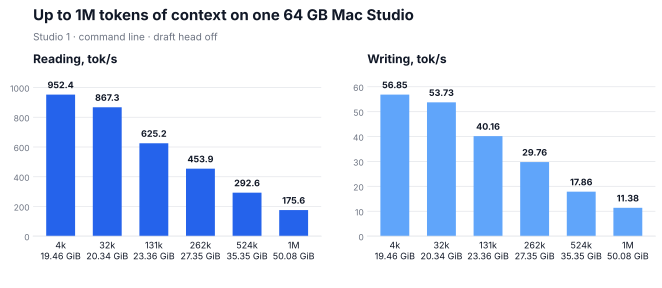

# Benchmarks and audit

The companion to the README. Every number here comes from a file in this repo, named next to it. The tables between
`<!-- gen:... -->` markers are written by `python scripts/charts.py` straight from the logs, never by hand.

**Scope.** All claims are for the M4 Max Mac Studio (40-core GPU, 64 GB) and nothing else. We have two of them:
*Studio 1* and *Studio 2*. Studio 2 runs about 5% slower than Studio 1 on the same code, so numbers are only compared
within one machine. The head-to-head vs MLX-Serve is on Studio 2.

**Model.** Official `thinkingmachines/Inkling-2-Mini` weights (Hub revision `ed40e7da`, NVFP4 + MXFP8) as shipped, bf16
KV cache. No requantizing, no FP8 KV, no sparse or approximate attention, anywhere in this document.

Contents: [the claim](#the-claim) · [head-to-head vs MLX-Serve](#head-to-head-vs-mlx-serve) ·
[quality](#quality-what-is-verified-on-what) · [settings](#settings-and-environment-variables) ·
[what did not work](#what-did-not-work) · [long context](#long-context-studio-1-command-line) ·
[not measured](#not-measured-yet) · [scripts](#scripts)

## The claim

| README says | Backed by |
|---|---|
| +5.4% faster writing at 4k, +4.3% at 32k | Sessions h29 and h30 below; our slowest counted run beats MLX-Serve's fastest in both sessions |
| +3.2% faster reading at 32k | Same, both sessions |
| Reading at 4k is level | Pooled +0.36%; in h30 the ranges overlap, so this is a tie, not a lead |
| 8/8 greedy answers identical to the reference, 520/520 teacher-forced top-1 | Gate g26 on the stack through 0018 (not the exact final stack, see [quality](#quality-what-is-verified-on-what)) |
| Hidden fact found in 12/12 of our head-to-head answers | `needle_found: True` on 6/6 requests in each of `srv-h29.out` and `srv-h30.out` |

Not claimed: anything on other Macs; concurrent or batched requests (both servers ran one request at a time); prompts
under 1,024 tokens (our draft head is off there); 131k and longer against MLX-Serve (running, see
[131k](#131k-pending)); the first request at a new prompt length (slower for us, [disclosed below](#our-first-request-at-each-prompt-length)).

## Head-to-head vs MLX-Serve

### Setup

- **Machine and order.** Studio 2. Both servers in the same session on the same Mac, one at a time: MLX-Serve first,
  stopped, then ours. h29 started 22:33 CET and h30 22:42 CET on 22 Nov 2026. The order was the same in every session
  (not alternated).
- **Same model and prompts.** Both load the same weights directory (`thinkingmachines--Inkling-2-Mini`, about 18.19 GB)
  with bf16 KV (MLX-Serve logs `kv-quant: off`). Prompts: MLX-Serve's own needle prompts
  `mlxserve/prompts/user-{4096,32768}.txt` (4,078 and 32,750 prompt tokens), greedy (temperature 0), `max_tokens` 256,
  streaming, one request at a time. Each server gets 4k three times, then 32k three times. MLX-Serve also gets a
  16-token warm-up at 4k first.
- **MLX-Serve.** `mlx-serve 26.11.4-pre-release.1` (ships MLX 0.32.5), its DSpark draft head (block 8), prefill chunk
  4096 (its own memory-sized choice), context 65,536, `--max-concurrent=1`. Rate from its log line
  `<- P+G tokens streamed [prefill: X tok/s, decode: Y tok/s]`. Full logs: `mlxserve-rerun-2233-draft-on.log` (h29),
  `mlxserve-rerun-2242-draft-on.log` (h30); the request lines are copied into `h2h29.log` / `h2h30.log`.
- **This repo.** `mlx_vlm.server` with every patch through 0019 (`scripts/install.sh`), mlx 0.32.4, the
  `scripts/serve.sh` settings: `scripts/env.sh` (draft head block 8, exact verify, confidence cut 0.65, 16,384-id
  candidate list), prefill step 8192, MLX buffer cache at the working-set size, async per-visit prefill eval,
  sliding-window attention in 64-query blocks; `--max-num-seqs 1`. Rate from the server's own log line
  (`LOG prompt_tokens=P ... prefill=X tok/s decode=Y tok/s`), copied into `h2h29.log` / `h2h30.log`. Client records
  with the needle check: `srv-h29.out`, `srv-h30.out`. The configuration is the one recorded in `docs/EXPERIMENTS.md`
  (22:33 and 22:42 entries); no environment snapshot or full server log was committed for these two sessions.
- **Token counts.** Each server counts its own: MLX-Serve logs 122 generated tokens at 4k and 125 at 32k, ours 123 and
  126. Rates are each server's tokens over its own time.
- All files are in `results/h2h-20261122/`.

### Counting and rounding

- **MLX-Serve:** every request except its 16-token warm-up, so 3 per prompt length per session.
- **This repo:** every request except the first one per prompt length after server start, so 2 per prompt length per
  session. That first request is our warm-up; [its numbers are below](#our-first-request-at-each-prompt-length).
- Means are plain means of the server-reported rates. Shown to 0.1 with **ours rounded down and MLX-Serve's rounded
  up**. Differences (Δ) are computed from the unrounded means and rounded down. So no rounding favours this repo.
- **Verdict.** *Faster* only if, in every session, our slowest counted run beats MLX-Serve's fastest. *Behind* if
  MLX-Serve's slowest beats our fastest in every session. Anything else is *level*. Per session the same test reads
  ahead / level / behind.

### Results, pooled over h29 and h30

<!-- gen:h2h-pooled -->
| Prompt | | MLX-Serve mean (n, range) | This repo mean (n, range) | Δ | Verdict |
|---|---|---:|---:|---:|---|
| 4k (4,078) | reading | 1,036.2 (6, 1,027.6–1,042.1) | 1,039.8 (4, 1,036.3–1,042.0) | +0.36% | level (+0.36%) |
| 4k (4,078) | writing | 76.3 (6, 75.6–76.8) | 80.4 (4, 80.1–81.1) | +5.49% | +5.4% faster |
| 32k (32,750) | reading | 898.5 (6, 897.8–899.0) | 927.8 (4, 927.3–928.5) | +3.27% | +3.2% faster |
| 32k (32,750) | writing | 72.6 (6, 70.9–74.2) | 75.7 (4, 75.1–76.6) | +4.38% | +4.3% faster |
<!-- /gen:h2h-pooled -->

### Every run, per session

<!-- gen:h2h-sessions -->
**h29**, started 2026-11-22 22:33 CET (`results/h2h-20261122/h2h29.log`)

| Prompt | | MLX-Serve runs | Mean | Our first request (not counted) | Our counted runs | Mean | Δ | Same-session |
|---|---|---|---:|---:|---|---:|---:|---|
| 4k | reading | 1,039.3, 1,027.6, 1,036.6 | 1,034.5 | 893.2 | 1,041.5, 1,039.7 | 1,040.6 | +0.58% | ahead |
| 4k | writing | 76.5, 76.6, 76.1 | 76.4 | 70.2 | 80.1, 80.5 | 80.3 | +5.10% | ahead |
| 32k | reading | 898.3, 898.1, 897.8 | 898.1 | 928.8 | 927.4, 928.2 | 927.8 | +3.31% | ahead |
| 32k | writing | 74.1, 72.3, 74.2 | 73.6 | 69.0 | 75.1, 75.7 | 75.4 | +2.53% | ahead |

**h30**, started 2026-11-22 22:42 CET (`results/h2h-20261122/h2h30.log`)

| Prompt | | MLX-Serve runs | Mean | Our first request (not counted) | Our counted runs | Mean | Δ | Same-session |
|---|---|---|---:|---:|---|---:|---:|---|
| 4k | reading | 1,037.0, 1,034.2, 1,042.1 | 1,037.8 | 855.4 | 1,042.0, 1,036.3 | 1,039.1 | +0.13% | level |
| 4k | writing | 75.6, 76.1, 76.8 | 76.2 | 69.2 | 80.2, 81.1 | 80.6 | +5.88% | ahead |
| 32k | reading | 898.9, 899.0, 898.4 | 898.8 | 926.7 | 927.3, 928.5 | 927.9 | +3.24% | ahead |
| 32k | writing | 70.9, 72.0, 71.6 | 71.5 | 70.2 | 75.4, 76.6 | 76.0 | +6.29% | ahead |
<!-- /gen:h2h-sessions -->

Notes on these numbers:

- `docs/EXPERIMENTS.md` gives h29 as +0.6% (4k reading) and +3.4% (32k reading), and the pooled 4k reading as +0.4%.
  The means give +0.58% (+0.5897%), +3.31% with our counted runs (+3.34% if our first 32k request is included) and
  +0.36%. The figures here are the re-derived ones.
- The h29 4k reading passes the per-session test (our 1,039.7 vs MLX-Serve's best 1,039.3) by 0.4 tok/s; h30 does not.
  4k reading is level.

### Our first request at each prompt length

Our first request at each prompt length is slower, MLX-Serve's is not. At 4k it is the first request after server
start: reading 893.2 and 855.4 tok/s, writing 70.2 and 69.2 tok/s, against 1,036–1,042 and 80–81 afterwards. At 32k
reading is unaffected (928.8 and 926.7), but **writing is soft: 69.0 tok/s in h29 and 70.2 in h30**, against 75.1–76.6
afterwards. The same happened in h28 (68.6). It looks like a one-time cost of a new prompt length (kernel compilation
for new shapes, or KV and buffer growth), not steady-state decoding; it has not been investigated further.
MLX-Serve's first 32k request shows no such dip (74.1 tok/s in h29, its fastest of three; 70.9 in h30, its slowest).

Counting these first requests changes the results as follows:

<!-- gen:h2h-first -->
| Prompt | | Our first requests | Δ per session, counted as warm-ups | Δ per session, first request counted | Pooled Δ, first request counted | Verdict, first request counted |
|---|---|---|---|---|---:|---|
| 4k | reading | 893.2 (h29), 855.4 (h30) | +0.58% (h29), +0.13% (h30) | −4.16% (h29), −5.77% (h30) | −4.97% | level |
| 4k | writing | 70.2 (h29), 69.2 (h30) | +5.10% (h29), +5.88% (h30) | +0.69% (h29), +0.87% (h30) | +0.78% | level |
| 32k | reading | 928.8 (h29), 926.7 (h30) | +3.31% (h29), +3.24% (h30) | +3.34% (h29), +3.19% (h30) | +3.27% | faster |
| 32k | writing | 69.0 (h29), 70.2 (h30) | +2.53% (h29), +6.29% (h30) | −0.37% (h29), +3.58% (h30) | +1.58% | level |
<!-- /gen:h2h-first -->

At 32k, counting our first request turns writing into a tie (−0.37% in h29, +3.58% in h30, +1.58% pooled); reading
stays ahead. At 4k the first request is the server's cold start, and MLX-Serve's own warm-up (its 16-token request) is
not counted on its side, so counting ours would set our cold start against its warm runs. The README's writing claims
are warm-run claims and say so.

### 131k (pending)

A same-session 131k head-to-head is running. Its log will land as `results/h2h-20261122/h2h31-131k.log`. To add it,
list it under `h2h_sessions` in `results/h2h-20261122/charts.json` and run `python scripts/charts.py`: the README table,
both charts and the tables above gain a 131k row under the same counting, rounding and verdict rules. A 262k session
can be added the same way. No 131k or 262k figure is claimed until its log is in this repo.

### How we got here (earlier runs on Studio 2)

Δ of our counted mean vs MLX-Serve's mean in each pair, same counting as above. The first pair is not same-session:
MLX-Serve's single run (prefill chunk 2048) is from 15:08 and ours from 19:09–19:16. Every later pair is same-session,
MLX-Serve first, and MLX-Serve chose prefill chunk 4096 in all of them.

<!-- gen:h2h-history -->
| Session (Studio 2) | Our stack | Reading 4k | Reading 32k | Writing 4k | Writing 32k | Logs |
|---|---|---:|---:|---:|---:|---|
| first, 19:09 CET | patches through 0016, env.sh, prefill step 2048 (not same-session: MLX-Serve's single run is from 15:08, chunk 2048) | −3.3% | −1.8% | +3.7% | −15.6% | `mlxserve-draft-on.log`, `srv-f2k.log` |
| g17b, 19:52 CET | + 0017 (server passes the prompt ids to the draft head) | −5.3% | −3.7% | +4.6% | +4.7% | `mlxserve-rerun-1952-draft-on.log`, `srv-g17b.log` |
| h26, 20:55 CET | + 0018 (last-chunk fold, lean draft prefill, early candidate list) | −4.9% | −3.4% | +5.6% | +6.5% | `mlxserve-rerun-2055-draft-on.log`, `srv-h26.log` |
| h27, 21:50 CET | + serve.sh (step 8192, no 1 GiB cache limit, async per-visit eval) | −2.5% | +0.4% | +4.7% | +6.1% | `mlxserve-rerun-2150-draft-on.log`, `srv-h27.log` |
| h28, 22:10 CET | + sliding-window attention in 64-query blocks (BQ_SWA=64) | −0.6% | +2.5% | +5.3% | +6.2% | `h2h28.log` |
| h29, 22:33 CET | + 0019 (l2 clips as one kernel per call): final stack | +0.5% | +3.3% | +5.1% | +2.5% | `h2h29.log` |
| h30, 22:42 CET | final stack, repeat | +0.1% | +3.2% | +5.8% | +6.2% | `h2h30.log` |
<!-- /gen:h2h-history -->

## Quality: what is verified on what

**Gate g26** (22 Nov 2026 21:00 CET, Studio 1; `results/h2h-20261122/gate26.log`, `top1-g26.json`). Stack: every patch
through 0018, `scripts/env.sh` defaults with the draft head on. Run with `scripts/quality/top1.py` (Python
`stream_generate`, prefill step 2048) on a fixed set of 8 prompts (6 corpus slices of 1,347 to 14,692 tokens with
questions, 2 chat prompts of 36 and 37 tokens):

- greedy 64-token answers through the draft head identical to the reference on **8/8** prompts;
- teacher-forced top-1 equal to the reference's teacher-forced argmax on **520/520** tokens (100%);
- 502/520 (96.54%) against the reference's greedy text, the same figure as in earlier gates. Because our teacher-forced
  argmax equals the reference's on all 520 tokens, the reference scores the same 502/520 against its own greedy text:
  the gap is between reading the answer back as a prefill and decoding it token by token, not this repo.

The reference is the unpatched community fork (`betizzel/mlx-vlm` at `55ca2e9e`) at prefill step 2048.

**Needle.** The harness line in both `h2h29.log` and `h2h30.log` reads `18 VIOLET-ANCHOR-4729` (logged as "needle
18/18" in `docs/EXPERIMENTS.md`). Our client records `srv-h29.out` and `srv-h30.out` show `needle_found: True` on all 6
of our requests in each session. The logs do not say which answers the harness count of 18 covers, so the README claims
only our 12/12.

**What changed after gate g26, and how each change was checked:**

| Change | Check | Source |
|---|---|---|
| Patch 0019: l2 clips as one Metal kernel per call (`PF_L2K`) | q/k/rel clips `array_equal` to the default at 4,077 rows on both Studios; server A/B output text identical in every run | `docs/EXPERIMENTS.md` (prefill l2 clips entry) |
| `MLX_VLM_RELATIVE_ATTN_BQ_SWA=64` (sliding-window attention in 64-query blocks) | bitwise equal to the default in every tile configuration tested (4,077 rows); same arithmetic, different tiling | `docs/EXPERIMENTS.md` (relative-attention tiles entry) |
| Async per-visit prefill eval, buffer cache at the working-set size | scheduling and memory allocation only; not separately gated | `scripts/serve.sh` |
| Prefill step 8192 in `serve.sh` (the gate uses 2048) | not gated (see below) | |

**Not done: the full gate (8-prompt greedy + teacher-forced top-1) has not been re-run on the exact final stack
(0019 + `BQ_SWA=64`) or with the `serve.sh` settings.** The README says so.

Two caveats beyond that:

- **Prefill chunk size.** The reference fork is not chunk-size invariant: changing the prefill step changes the last
  bits of the hidden states (fork against itself, step 4096 vs 2048: teacher-forced top-1 99.6% on the 8 prompts,
  needle answers identical, `results/gates/studio2/top1/top1-fork-step4096.json`). `serve.sh` uses step 8192, which
  has not been through the 8-prompt gate. MLX-Serve uses its own chunk (4096).
- **Patch 0011** (compiled decode from 1,024 keys, `MLX_VLM_INKLING2_DECODE_MIN_KEYS=1024`, on by default). Below
  4,096 keys it uses split-K attention, which adds in a different order: tokens identical on the gate (it is part of
  g26), log-probabilities not bit-identical. Prompts of 4,096 tokens or more are unaffected.

**The draft head** never changes the output: its guesses are verified with the single-token decode step's own kernels
and reduction order (patch 0007), so the tokens are the same as decoding without it. Checked in g26 (greedy through the
draft head) and in every draft run since 0007 (tokens identical to the no-draft run).

### Earlier exactness results (bit level)

- Stack6 (`stacked.patch` = 0001 + 0002 + 0003): tokens **and** the sha256 of every per-token log-probability vector
  identical to the unpatched fork at 4k, 32k, 131k and 262k (`results/gates/gate-stack6-20261122-1108.log`,
  `results/gates/s6-*.json`; references in `results/reference/`).
- 0008 and 0009 at 1M: tokens and log-probability sha identical to the run without them (`results/gates/h7-1m-kt3-hostvocab.json`).
- 0010 at step 2048: tokens and log-probability sha equal to the fork at 4k and 32k (`results/gates/studio2/p10b-*.json`).
- 0007 (exact draft verify, block 4): tokens and log-probability sha equal to the fork's no-draft run at 32k, 131k
  and 262k (`results/gates/gate-stack7-draft-20261122-1153.log`, `results/gates/s7-draft-k4-*.json`).

### Exactness methodology

1. Fixed prompt: Project Gutenberg text truncated to the target context, needle sentence inserted at the first
   paragraph break past the midpoint, question at the end.
2. Greedy decoding (`temperature=0`), fixed `prefill_step_size` (2048), 256 max tokens.
3. For every generated token, record the token id and hash the full float32 log-probability vector into one running
   sha256 (`scripts/exact_check.py`).
4. Run the unpatched fork and the patched build in the same venv (only `PYTHONPATH` differs) and require identical
   token lists and identical sha. The needle must be found.
5. Promotion ladder: kernel microbenchmarks bitwise equal (or max-abs-diff 0) on random inputs, then a 32k end-to-end
   gate, then 131k. A variant that changes any bit is rejected or reported as non-exact.
6. Relaxed gate for changes that cannot be bitwise (chunk size, 0011): `scripts/quality/top1.py`, the same greedy
   answers on the 8 prompts and at least 99% teacher-forced top-1.

### Standard quality benchmarks (older build)

Run 22 Nov 2026 08:59–11:09 CET on Studio 1. Script, sample ids, raw per-item JSONL, telemetry and summary:
`results/quality-20261122/`. *Standard* = inkling2-mlx v0.2.0 (MLX-VLM `0.8.0+inkling2mini.2`). *This repo* = the
`stack4` build (fork + 0001 + 0002 + 0003), no draft head. Same weights, same chat template (`reasoning_effort="low"`),
greedy, prefill step 2048, one request at a time.

| Benchmark | n | Standard build | This repo | Paired (std only / repo only) | Token-identical items |
|---|---:|---:|---:|---|---:|
| GSM8K (first 100) | 100 | 97 (97.0%, 95% CI 91.5–99.0) | 99 (99.0%, 94.6–99.8) | 0 / 2, McNemar p = 0.50 | 23 / 100 |
| MMLU-Pro (10 per subject) | 140 | 110 (78.6%, 71.1–84.6) | 109 (77.9%, 70.3–83.9) | 7 / 6, p = 1.00 | 11 / 140 |
| RULER NIAH 32k | 12 | 12 (100%) | 12 (100%) | 0 / 0 | 4 / 12 |

Neither difference is significant. Against the community fork (our base), this repo was token-for-token identical on
all 100 GSM8K items; tokens differ from the standard build because it is different code (greedy decoding drifts at the
first near-tie). MMLU-Pro truncations at 2,048 tokens: 11 standard / 8 repo, counted as wrong.

## Settings and environment variables

### Patches applied by `scripts/install.sh`

All patches are `patch -p1` from the fork's source root (`betizzel/mlx-vlm` at `55ca2e9e`).

| Patch | What | Exact? |
|---|---|---|
| `stacked.patch` | 0001 + 0002 + 0003 combined: memory-lean long context (last-token head, per-chunk embedding, one-shot KV reservation), one compiled decode step with fused MoE / attention / gate kernels, prefill attention tiles and a sort-free MoE permutation | bitwise |
| 0008 | Global attention tiles stage three key blocks per barrier (`MLX_VLM_RELATIVE_ATTN_KTILES=3`) | bitwise |
| 0009 | Vocabulary tables in host memory during long prefill (`MLX_VLM_EXACT_HOST_VOCAB=1`) | bitwise |
| 0010 | Fused prefill kernels: attention residuals, message gates, MoE route-combine, short conv, l2 clips (`MLX_VLM_INKLING2_PREFILL_FUSED=1`) | bitwise |
| 0011 | Compiled decode from 1,024 keys (`MLX_VLM_INKLING2_DECODE_MIN_KEYS=1024`) | same tokens on the gate; log-probs differ below 4,096 keys |
| 0007 | Draft head with an exact verifier, windowed draft context | same tokens as no draft |
| 0012 | Draft confidence cut, draft context limits | same tokens |
| 0014 | Server: one greedy request decodes through the compiled step | same tokens |
| 0015 | Server: one drafted request runs the exact-verify round loop | same tokens |
| 0016 | Draft proposes from a 16,384-id candidate list (`data/draft_vocab_order.json`) + the prompt's ids, compiled Markov loop | same tokens |
| 0017 | Server passes the prompt ids to the draft head | same tokens |
| 0018 | Server: last chunk and last token in one forward, lean draft prefill, candidate list built during prefill, message-gate casts inside the compiled tail | bitwise (casts); same tokens |
| 0019 | Prefill l2 clips as one Metal kernel per call | bitwise in its own tests |

Optional: `PREFIX=1` adds the prefix cache (0004 + 0006, or 0013 on top of the draft head; 0013 not measured end to
end). `NO_DRAFT=1` skips the draft-head patches. `DSPARK=1` builds the older 0005 compiled verify on
`stacked-v4.patch` (same tokens, not bitwise). Per-patch history: `docs/EXPERIMENTS.md`.

### Environment

Set by `scripts/env.sh` (the defaults):

| Variable | Value | Effect |
|---|---|---|
| `MLX_VLM_EXACT_PREFILL_EVAL_EVERY` | 1 | evaluate after every prefill layer visit (memory; scheduling only) |
| `MLX_MAX_MB_PER_BUFFER` | 2 | MLX command-buffer size (scheduling only) |
| `MLX_VLM_RELATIVE_ATTN_KTILES` | 3 | 0008 global attention tiles |
| `MLX_VLM_EXACT_HOST_VOCAB` | 1 | 0009 host vocabulary tables |
| `MLX_VLM_RELATIVE_ATTN_BQ_SWA` | 64 | sliding-window attention in 64-query blocks (default 32) |
| `MLX_VLM_INKLING2_PREFILL_FUSED` | 1 | 0010 fused prefill kernels |
| `MLX_VLM_INKLING2_DECODE_MIN_KEYS` | 1024 | 0011 (default 4096) |
| `MLX_VLM_DRAFT_MODEL`, `MLX_VLM_DRAFT_BLOCK_SIZE` | model dir, 8 | draft head on, block 8 |
| `MLX_VLM_INKLING2_INCREMENTAL_DRAFT_PREFILL` | 1 | draft head's view of the prompt captured per chunk |
| `MLX_VLM_INKLING2_EXACT_VERIFY`, `MLX_VLM_INKLING2_COMPILED_VERIFY` | 1, 1 | 0007 exact verifier |
| `MLX_VLM_INKLING2_DRAFT_CTX_WINDOW` | 65536 | draft head context window |
| `MLX_VLM_INKLING2_DRAFT_CONF` | 0.65 | 0012 confidence cut |
| `MLX_VLM_INKLING2_DRAFT_COMPILE`, `MLX_VLM_INKLING2_DRAFT_VOCAB` | 1, 16384 | 0016 compiled loop, candidate list size |
| `MLX_VLM_INKLING2_DRAFT_MIN_CTX`, `MLX_VLM_INKLING2_DRAFT_MAX_CTX` | 1024, 262144 | draft head off outside this context range |
| `MLX_VLM_BATCH_CACHE_EVAL_INTERVAL` | 0 | no cache clears inside an answer (server) |
| `MLX_VLM_SERVER_FOLD_LAST`, `MLX_VLM_INKLING2_DRAFT_LEAN_PREFILL` | 1, 1 | 0018 |

`NO_DRAFT=1` leaves out the draft and server-draft variables. `scripts/serve.sh` adds
`MLX_VLM_EXACT_PREFILL_EVAL_ASYNC=1` (async per-visit eval), `--prefill-step-size 8192` (`STEP` overrides),
`--max-num-seqs 1`, and sets MLX's memory, wired and buffer-cache limits to the recommended working-set size (the
server's default 1 GiB cache limit made prefill re-allocate its buffers on every visit).

On by default inside the patches (set to `0` to switch off): `PF_L2K` and `PF_L2KS` (0019), `PF_MGC` (0018),
`PF_AR`, `PF_MG`, `PF_MOE`, `PF_SC`, `PF_L2` (0010 parts, with `PREFILL_FUSED=1`), `MLX_VLM_INKLING2_SERVER_COMPILED_DECODE`
(0014), `MLX_VLM_INKLING2_SERVER_PLAIN_SPEC` (0015; `0` restores the batching path), `MLX_VLM_INKLING2_DRAFT_VOCAB_EARLY`
(0018), `MLX_VLM_SERVER_PREFILL_CLEAR_CACHE`.

Opt-in experiments, off, not used for any number in the README: `PF_MGF=1` (fused message-gate tail; bitwise, no
end-to-end gain), `PF_GU=1` (fused gate+up expert GEMM; no gain), `PF_POSTSCALE=1` (MLX-Serve's expert scale layout;
slower), `PF_ARX=0` and `PF_MGX=0` (older approximate kernels; not bitwise, `PF_ARX=0` failed the 99% top-1 gate),
`PF_PJ=1` (merged projections; not bitwise), `MLX_VLM_SERVER_STEP_LONG` (long-prompt step override; no gain),
`MLX_VLM_INKLING2_DRAFT_VOCAB_FILE` (another candidate list), `MLX_VLM_INKLING2_DRAFT_TIMERS` and
`MLX_VLM_INKLING2_SPEC_LOG` (logging), `APC_ENABLED=1` (prefix cache, needs `PREFIX=1`).

## What did not work

Short version of `docs/EXPERIMENTS.md`, which has every attempt. S1 / S2 = Studio 1 / Studio 2; server log, warm run.

**Reading (prefill)**

- Fused gate+up expert GEMM (`PF_GU`): 1,062.3 / 940.2 vs 1,063.2 / 941.7 tok/s (S1, 4k / 32k). The expert GEMM is
  compute-bound; a wider N doesn't help.
- Attention projections as one GEMM over concatenated weights (bitwise): 10.51 → 10.50 ms at 4,077 rows. Compute-bound;
  saves one launch.
- Merged q/k/v/r/gate projections (`PF_PJ`): bitwise at 2,048 rows only, teacher-forced top-1 98.5% across row counts.
  Dropped.
- The older approximate fusions (`PF_ARX=0`, `PF_MGX=0`): +0.7% / +0.5% on S2, but `PF_ARX=0` was at 98.5% top-1,
  below the 99% gate. Not used.
- MLX-Serve's expert layout (plain NVFP4 gathers, scale applied afterwards, `PF_POSTSCALE=1`): slower on mlx 0.32.4
  (1,062.6 / 938.2 vs 1,068.1 / 942.2, S1) and on mlx 0.32.4 + MLX PR #4709 built from source (973.2 / 863.3 vs
  976.5 / 865.7, S2).
- Expert GEMM reading rows in place via `lhs_indices` (`PF_LHS=1`): 4k 354.9, 32k 341.1. MLX picks a much slower
  gather kernel when `lhs_indices` isn't the identity.
- Fused message-gate tail (`PF_MGF=1`): bitwise, 0.46 → 0.37 ms per gate in isolation, no end-to-end gain (overlapped).
- MoE softcapped SwiGLU as one kernel: bitwise version 1.59–1.78 → 0.86–0.88 ms in the microbench, no server gain
  (1,126.3 / 1,001.1 vs 1,126.4 / 1,002.8, S1). Not kept.
- Value norm and casts through `rms_norm_cast` (`PF_VN`): 0.50 → 0.56 ms per visit. Not kept.
- Global-visit attention tile variants at 4k (BQ128, KT1/KT2, pipelined QK, padding): base 9.70 ms was best or level.
- Server prefill step 3072 / 2560 / 4096 with the 1 GiB cache limit: slower than 2048; a long-prompt-only step
  override: no gain. `EVAL_EVERY=0` or no `MLX_MAX_MB_PER_BUFFER=2`: slower. 8 MB command buffers, 200 ops per
  buffer: noise.

**Writing (decode and draft head)**

- Non-exact compiled verify (`EXACT_VERIFY=0`): slower (32k block 8: 46.0 / 47.1 vs 59.4 tok/s) and acceptance moved,
  so not exact. Dropped.
- First draft-head port without the exact verifier: slower than no draft at 131k–262k (26.2 / 23.9 vs 39.9 / 29.6).
- 0005 without `SPLITK_VERIFY=shared` at 131k: 24.2 tok/s, slower than no draft.
- Draft candidates as "ids below N": acceptance 88% → 71%, 62–64 tok/s (this tokenizer's common English words sit
  around ids 149k–156k). Replaced by the frequency-ordered list (0016).
- Draft context window 8k: acceptance drops, 56.9 tok/s. Pre-building the verify for the likeliest cut: 71.5 (no help).
- Adaptive block-size selector: settles on its largest candidate in ~125-token answers, adds nothing.
- `CONF_MIN=0` (allow verifying only the bonus token), τ 0.8: 32k 80.9 vs 81.8, τ 0.8 86.3 / 78.6 vs 87.4 / 81.8 (S1).
- betizzel 5a3c6132 router half (cached FP32 router weight): 952.5 vs 952.4 reading, no gain.

## Long context (Studio 1, command line)

This repo without the draft head, one Mac Studio M4 Max 64 GB (Studio 1), bf16 KV, batch 1, greedy, needle
(`VIOLET-ANCHOR-4729`) inserted mid-document in public-domain Project Gutenberg text, prefill step 2048, 256 max new
tokens, `scripts/exact_check.py`. Needle found in every row. These runs predate patches 0010–0019.

| Context (prompt tokens) | Reading tok/s | Writing tok/s | Peak MLX GiB | Standard build: reading / writing / peak | Speed-up (reading / writing) | Exactness |
|---|---:|---:|---:|---|---|---|
| 4k (4,078) | 952.4 | 56.85 | 19.46 | 758.4 / 33.09 / 25.58 | 1.25× / 1.71× | bit-identical to the fork |
| 32k (32,750) | 867.3 | 53.73 | 20.34 | 667.9 / 27.0 / 28.27 | 1.29× / 1.99× | bit-identical to the fork |
| 131k (131,054) | 625.2 | 40.16 | 23.36 | 401.9 / 16.2 / 33.58 | 1.55× / 2.47× | bit-identical to the fork |
| 262k (262,126) | 453.9 | 29.76 | 27.35 | 256.4 / 10.7 / 35.38 | 1.77× / 2.78× | bit-identical to the fork |
| 524k (524,270), previous build | 292.6 | 17.86 | 35.35 | not measured | – | needle found |
| 1M (1,048,558), KT=3 + host vocab, text-only | 175.6 | 11.38 | 50.08 | not measured | – | needle found; tokens + sha equal to the 163.3 run |
| 1M, without 0008/0009 env | 163.3 | 11.36 | 50.76 | | | needle found |
| 1M, step 512, previous build | 156.0 | 10.04 | 50.04 | | | needle found |

Speed-ups are the measured ratios rounded down. *Standard build* = inkling2-mlx v0.2.0 (MLX-VLM `0.8.0+inkling2mini.2`)
with mlx 0.32.4 on the same Mac, weights and prompts (`results/runs/stock-v0.2.0-*.json`); it needed smaller prefill
steps (1024 / 512 / 256) to fit. There is no 524k or 1M standard-build run (an earlier 524k run on the unpatched fork
was stopped after 14 minutes, still reading).

Sources: 4k–262k `results/gates/gate-stack6-20261122-1108.log` and `results/gates/s6-*.json` (stack6, recommended env);
524k `results/gates/h-524k.json` (`stacked-v4.patch`); 1M `results/gates/h7-1m-kt3-hostvocab.json` and `.log`
(14:30–16:10 CET; env + `MLX_VLM_RELATIVE_ATTN_KTILES=3 MLX_VLM_EXACT_HOST_VOCAB=1`), `results/gates/h6-1m-step2048.json`
(163.3), `results/gates/h-1m.json` (156.0). The 1M run read 1,048,558 tokens in about 1 h 40 min at 175.6 tok/s, peak
50.08 of the 51.84 GiB GPU limit, vision tower dropped (`scripts/exact_text_only.py`, text logits unchanged). The 1M
step-2048 and step-512 runs wrote the same answer, but their tokens differ from position 9: the fork itself is not
chunk-size invariant, and there is no unpatched 1M reference at either step.

**Why 1M fits.** At 1M the weights (17.6 GiB) plus the reserved KV (32 GiB) sit at MLX's buffer-cache line
(0.95 × the recommended working set, 49.25 GiB); past it MLX's allocator frees its cache on every miss and every op
gets fresh Metal buffers (+20–30% per layer). Keeping the two 0.86 GiB vocabulary tables in host memory during the
chunked prefill and moving them back before the last token keeps the GPU under that line (`docs/EXPERIMENTS.md`,
14:11–14:30).

**Draft head at long context** (patch 0007, block 4, `scripts/exact_check_draft.py`,
`results/gates/gate-stack7-draft-20261122-1153.log`, `results/gates/s7-draft-k4-*.json`):

| Context | Reading tok/s | Writing tok/s (no draft → draft) | Accepted / drafted | Peak GiB | vs unpatched fork (no draft) |
|---|---:|---:|---:|---:|---|
| 32k | 864.9 | 53.73 → 65.99 | 77% | 21.41 | tokens and sha identical |
| 131k | 622.7 | 40.16 → 52.67 | 77% | 24.41 | tokens and sha identical |
| 262k | 452.2 | 29.76 → 35.72 | 59% | 28.41 | tokens and sha identical |

**Prefix cache** (fork server with APC + 0004, 131k document and a follow-up, client-side times,
`results/prefix-cache-131k-server.log`): turn 1 cold 219.5 s to first token, turn 2 (131,006 tokens restored) 1.54 s.
Not yet measured stacked with the speed patches.

### Roofline

Machine limits: 14.2 TFLOP/s fp16/bf16 FMA (measured on M4 Max by third parties; 16.2 on paper) and 546 GB/s DRAM
bandwidth (spec; 444–458 GB/s achievable in our read benchmarks).

Prefill: 8.84 GFLOP per prompt token for the dense work over the 48 layer visits, 0.50 GFLOP for the 40
sliding-window visits, plus 98,304 × S_avg FLOP for the 8 global visits (S_avg = N/2).

| Context | GFLOP/token | Ceiling tok/s | Measured | % of ceiling |
|---|---:|---:|---:|---:|
| 32k | 10.95 | 1,297 | 865.3 | 66.7% |
| 131k | 15.78 | 900 | 624.3 | 69.4% |
| 262k | 22.22 | 639 | 453.6 | 71.0% |
| 524k | 35.11 | 404 | 292.6 | 72.4% |
| 1M (KT=3 + host vocab) | 60.88 | 233 | 175.6 | 75.4% |

Decode: each token reads 5.50 GB of active weights (`results/decode-weight-bytes.json`) plus 0.17 GB of sliding KV and
32 KiB × S of global KV.

| Context | GB/token | Ceiling tok/s | Measured (no draft) | % of ceiling |
|---|---:|---:|---:|---:|
| 32k | 6.74 | 81.0 | 53.73 | 66% |
| 131k | 9.96 | 54.8 | 40.16 | 73% |
| 262k | 14.26 | 38.3 | 29.76 | 78% |
| 1M (KT=3 + host vocab) | 40.03 | 13.6 | 11.38 | 84% |

Details: `docs/trackA-prefill-notes.md`, `docs/trackB-decode-notes.md`, `docs/PREFILL_TECHNIQUES.md`.

## Not measured yet

- The 131k head-to-head vs MLX-Serve (running; [131k](#131k-pending)).
- The full quality gate on the exact final stack and the `serve.sh` settings (prefill step 8192).
- Why our first request at a new prompt length is slower.
- Concurrent requests: both servers were measured one request at a time.
- Prompts under 1,024 tokens: the draft head is off there, and chat-length writing takes a slower decode path.
- The draft head at 524k and 1M (it switches itself off above 262,144 tokens), and the prefix cache combined with the
  draft head (0013).
- 1M with patches 0010–0019.
- Any Mac other than the M4 Max Mac Studio 64 GB.

## Scripts

| Script | Purpose |
|---|---|
| `scripts/install.sh` | Fork zip → unpatched and patched source trees and a venv |
| `scripts/env.sh`, `scripts/serve.sh` | Default environment; OpenAI-compatible server with the benchmarked settings |
| `scripts/charts.py` | Charts, README table and the generated tables here, from the logs (`--png` for PNG copies) |
| `scripts/gate.sh`, `scripts/exact_check.py`, `scripts/exact_check_draft.py` | Exactness and speed gate: token ids and log-probability sha, unpatched vs patched |
| `scripts/quality/top1.py` | 8-prompt greedy + teacher-forced top-1 gate |
| `scripts/probe_exact.py`, `scripts/memprof.py` | Synthetic-depth memory probe; per-chunk working-memory profiler |
| `scripts/exact_text_only.py` | Drops the vision tower for text-only runs (text logits unchanged) |
| `scripts/prefix_cache.sh`, `scripts/followup.py`, `scripts/test_inkling2_prefix_cache.py` | Prefix-cache server, two-turn measurement, tests |
| `scripts/draft_vocab.py` | Rebuilds `data/draft_vocab_order.json` (byte-identical) |

Paths default to `~/inkling-mini` (`ROOT`). Run one GPU job at a time. Some older run JSONs had local usernames in
paths replaced with `~` and machine-specific fields (process lists, network details) removed; numbers are unchanged.
